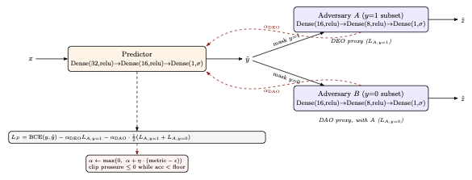

# Adaptive Alpha Control

A research project on fairness in machine learning. Adversarial debiasing (Zhang et al., 2018) normally uses one fixed weight, alpha, to set how hard a predictor works against an adversary that tries to recover a sensitive attribute. I replaced that fixed weight with two weights updated every epoch by dual ascent, then compared the result against a plain model, a fixed-alpha sweep and post-processing equalized-odds calibration (Hardt et al., 2016) on COMPAS and German Credit. Everything is written in TensorFlow/Keras, and the write-up is in [paper/paper.pdf](paper/paper.pdf).



## How it works

The predictor is a small dense network (32, 16, 1 units). Each adversary is another small dense network (16, 8, 1 units) that only sees the predictor's output score, so it can only guess the sensitive attribute if that score leaks it.

Fairness is measured with two gaps between groups:

- DEO, the absolute difference in true positive rate
- DAO, the mean of the absolute differences in true positive rate and false positive rate

The four conditions compared are:

1. Baseline: the predictor on its own, trained with binary cross-entropy.
2. Fixed alpha: predictor and one adversary trained with alternating updates each minibatch, predictor loss `BCE(y, y_hat) - alpha * BCE(z, z_hat)`, for alpha in 0.5, 1.0 and 2.0.
3. Adaptive (my method): two adversaries, one trained on the rows with y = 1 and one on the rows with y = 0. After each epoch the two multipliers move by `alpha <- max(0, alpha + 0.5 * (gap - target))`, where each target is 30% of the dataset's measured baseline gap. If accuracy is below a floor (0.60 for COMPAS, 0.66 for German Credit), alpha is allowed to fall but not rise.
4. Post-processing: train the baseline predictor, then pick per-group randomised thresholds from each group's ROC convex hull so both groups share one (FPR, TPR) point, chosen to maximise accuracy.

Data preparation is in `src/data.py` and `src/data_german.py`. COMPAS is filtered the way ProPublica filtered it and restricted to African-American and Caucasian defendants, leaving 5,278 rows and 12 features. German Credit has 1,000 rows and 56 features after one-hot encoding, with gender as the sensitive attribute. Both use one stratified 80/20 split with `random_state=42`, so seeds only change weight initialisation and batch order. Every model trains for 30 epochs with Adam (learning rate 1e-3, batch size 64).

## Results

Mean ± standard deviation over 30 seeds (0 to 29). Baseline, fixed alpha and adaptive are scored on the full test split (1,056 rows for COMPAS, 200 for German Credit). Post-processing fits its thresholds on a random half of the test split and is scored on the other half.

COMPAS:

| Condition | Accuracy | DEO | DAO |
|---|---|---|---|
| Baseline | 0.657 ± 0.005 | 0.249 ± 0.012 | 0.207 ± 0.015 |
| Fixed alpha 0.5 | 0.648 ± 0.005 | 0.244 ± 0.014 | 0.203 ± 0.020 |
| Fixed alpha 1.0 | 0.638 ± 0.010 | 0.227 ± 0.022 | 0.192 ± 0.019 |
| Fixed alpha 2.0 | 0.615 ± 0.011 | 0.167 ± 0.023 | 0.131 ± 0.023 |
| Adaptive | 0.609 ± 0.009 | 0.127 ± 0.019 | 0.144 ± 0.014 |
| Post-processing | 0.631 ± 0.020 | 0.061 ± 0.045 | 0.060 ± 0.040 |

German Credit:

| Condition | Accuracy | DEO | DAO |
|---|---|---|---|
| Baseline | 0.721 ± 0.016 | 0.058 ± 0.037 | 0.053 ± 0.025 |
| Fixed alpha 0.5 | 0.726 ± 0.016 | 0.063 ± 0.039 | 0.056 ± 0.030 |
| Fixed alpha 1.0 | 0.729 ± 0.015 | 0.045 ± 0.027 | 0.057 ± 0.027 |
| Fixed alpha 2.0 | 0.726 ± 0.015 | 0.047 ± 0.028 | 0.053 ± 0.023 |
| Adaptive | 0.722 ± 0.016 | 0.049 ± 0.036 | 0.049 ± 0.025 |
| Post-processing | 0.711 ± 0.036 | 0.061 ± 0.055 | 0.105 ± 0.067 |

Paired Wilcoxon signed-rank tests with Holm correction are in `results/significance_compas.txt` and `results/significance_german.txt`. On COMPAS, adaptive against fixed alpha 2.0 gave no significant accuracy difference (p_holm = 0.087), a lower DEO (p_holm = 4.7e-5) and a higher DAO (p_holm = 0.027). Post-processing beat adaptive on all three metrics. On German Credit the only significant differences were post-processing's higher DAO against adaptive, fixed alpha 2.0 and baseline (p_holm = 0.0012, 0.0011 and 0.0030).

Two 5-seed checks are also logged. Annealing the targets from the baseline gap down to the final target gave 0.626 / 0.164 / 0.151 (accuracy / DEO / DAO), and a gradient-reversal version of the fixed-alpha game at strength 2.0 gave 0.613 / 0.165 / 0.130.

## Repository layout

| Path | What it is |
|---|---|
| `paper/paper.tex`, `paper/paper.pdf` | The write-up |
| `paper/figures/architecture.tex` | TikZ source for the architecture diagram |
| `paper/figure_plan.html` | Planning page for the paper's figures |
| `src/data.py`, `src/data_german.py` | Loading, filtering, encoding and splitting |
| `src/models.py`, `src/metrics.py` | Network definitions and the accuracy, DEO and DAO metrics |
| `src/train_baseline.py`, `src/train_fixed_alpha.py`, `src/train_adaptive_alpha.py` | Single-seed training scripts that print per-epoch metrics |
| `src/run_*seeds*.py` | 30-seed runners for each condition and dataset |
| `src/postprocess_equalized_odds_german.py`, `src/experiments/` | Post-processing, annealed targets and gradient reversal |
| `src/significance_test.py` | Paired Wilcoxon tests with Holm correction |
| `src/make_pareto_plot.py`, `src/export_site_results.py` | Plotting and export helpers |
| `results/` | Raw output from every run and the significance tables |
| `data/` | COMPAS two-year recidivism CSV and German Credit TSV |
| `PLAN.md`, `EXPERIMENTS.md`, `REFERENCES.md` | Working notes, experiment log and checked citations |
| `archive/v1/` | The earlier version of the project, built on UCI Adult with a different controller and Weights & Biases logging |

## Running it

The logs were produced with Python 3.11. There is no requirements file; the code imports TensorFlow, NumPy, pandas, scikit-learn, SciPy and Matplotlib. Run everything from the repository root so the `data/` paths resolve:

```bash
pip install tensorflow numpy pandas scikit-learn scipy matplotlib

python -m src.run_baseline_seeds            # COMPAS baseline, 30 seeds
python -m src.run_fixed_seeds               # COMPAS fixed alpha 0.5 / 1.0 / 2.0
python -m src.run_seeds                     # COMPAS adaptive
python -m src.experiments.postprocess_equalized_odds 30

python -m src.run_baseline_seeds_german
python -m src.run_fixed_seeds_german
python -m src.run_seeds_german
python -m src.postprocess_equalized_odds_german

python -m src.experiments.annealed_epsilon 5
python -m src.experiments.gradient_reversal 5
python -m src.significance_test             # COMPAS comparisons
python -m src.make_pareto_plot              # redraws paper/pareto_frontier.png from results/
```

Each runner prints one line per seed and a summary; the files in `results/` are those outputs saved to disk. The COMPAS data comes from ProPublica's analysis described in their [Machine Bias](https://www.propublica.org/article/machine-bias-risk-assessments-in-criminal-sentencing) article.

## Limitations

- There is no validation split. The adaptive controller reads DEO, DAO and accuracy on the test split after every epoch, and the same split is used for the reported numbers.
- Post-processing calibrates on half of the test split and is scored on the other half, so its numbers come from 528 COMPAS rows or 100 German Credit rows rather than the full test split used for the other conditions.
- The annealing and gradient-reversal checks used 5 seeds.
- `src/significance_test.py` only runs the COMPAS comparisons. The German Credit table was made by changing its inputs by hand.
- `src/export_site_results.py` still reads logs from `/tmp`.
- Both sensitive attributes are treated as binary, and DEO and DAO cover only two of many fairness definitions.
